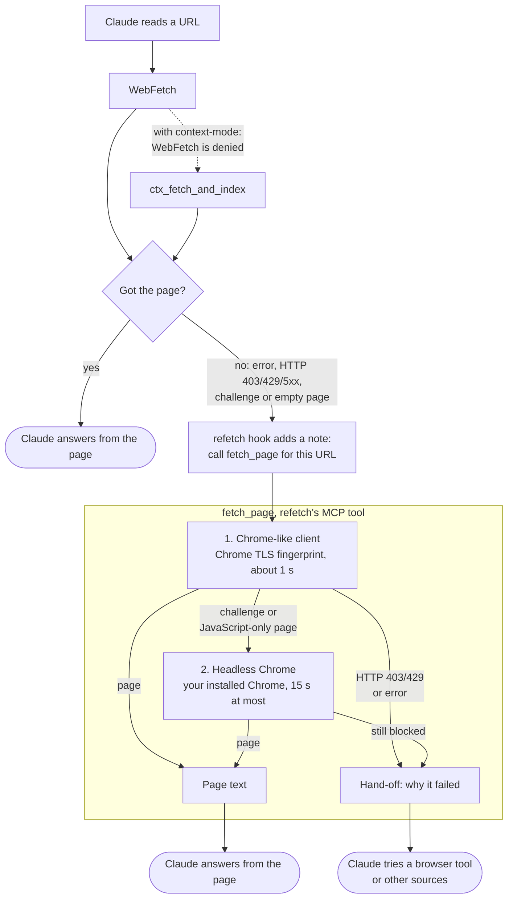

# refetch

**When Claude Code's WebFetch gets blocked, refetch reads the page.**

[](https://github.com/samgozman/refetch/actions/workflows/ci.yml)
[](https://github.com/samgozman/refetch/releases/latest)
[](go.mod)
[](LICENSE)

A Claude Code plugin for the pages WebFetch cannot read: HTTP 403 and 429,
"Just a moment..." challenges, JavaScript-only pages and timeouts. You don't
change how you work. When a read fails, refetch steps in on its own and
Claude gets the page.

```text
> What does the headline on https://www.indeed.com/ say?

  WebFetch      https://www.indeed.com/  ->  HTTP 403 Forbidden
  refetch hook  tells Claude to call fetch_page with this URL
  fetch_page    https://www.indeed.com/  ->  HTTP 200, Chrome-like client

  The headline reads "Your next job starts here".
```

In a test of 10 everyday prompts, mostly on sites that block bots, Claude read 2
pages with WebFetch alone and 6 with refetch. That was before the headless
Chrome step, which adds JavaScript-only pages and some challenges.

```text
/plugin install refetch --marketplace samgozman/refetch
```

## Why refetch

- **Automatic.** Hooks catch the failed read and point Claude at refetch in
  the same turn. No prompt changes, no new habits.
- **Fast and small.** One Go binary of about 8 MB to download. The first
  step takes about 1 s. Headless Chrome runs only when a page needs it, and
  uses the Chrome you already have.
- **Gets past what stops WebFetch.** A client with Chrome's TLS fingerprint
  first, then real headless Chrome for challenges and JavaScript-only pages.
- **Plays well with others.** Works next to
  [context-mode](https://github.com/mksglu/context-mode) and
  [RTK](https://github.com/rtk-ai/rtk), and never denies or rewrites a tool
  call.
- **Shows its value.** `refetch stats` reports how many reads failed, how
  many refetch picked up and which step resolved them. All data stays on
  your machine.
- **Safe by default.** Public addresses only, one page per call, no
  crawling, no cookies kept.

## Install

refetch runs on macOS and Linux. In Claude Code 2.1.275 or later:

```text
/plugin install refetch --marketplace samgozman/refetch
```

On older versions, use two commands:

```text
/plugin marketplace add samgozman/refetch
/plugin install refetch@refetch
```

The first session after install downloads the refetch binary for your
platform (about 8 MB) from this repo's GitHub release and checks it against
the sha256 pinned in the plugin.

### Allow fetch_page

Without this rule, every rescue waits on a permission prompt and fails
outright under `claude -p`. Add it to `~/.claude/settings.json`:

```json
{
  "permissions": {
    "allow": ["mcp__plugin_refetch_refetch__fetch_page"]
  }
}
```

### Turn on auto-update

Claude Code does not auto-update plugins from third-party marketplaces
unless you turn it on: `/plugin` → Marketplaces → refetch → Enable
auto-update. New versions load on the next launch or `/reload-plugins`. To
update by hand, run `claude plugin update refetch@refetch`.

### Check the setup

Ask Claude to run `refetch doctor`, or run it yourself. It checks the
binary and plugin versions, the permission rule, Chrome, the stats file and
other hooks on WebFetch.

## How it works

refetch sits after Claude Code's own web reads. It changes nothing while
they work and steps in only when one fails.



The hook and `fetch_page` record every step locally, so `refetch stats` can
show how often each path was taken. Step by step:

1. WebFetch runs as usual. refetch only reacts after a failed read, or after
   a "successful" read that is really an error page, challenge or empty
   JavaScript shell.
2. The hook adds a note next to the failed result telling Claude to call
   `fetch_page` with that URL.
3. `fetch_page` reads the page with a Go HTTP client whose TLS handshake
   looks like Chrome's (about 1 s, no JavaScript). A plain Go client is only
   its backup for the Chrome-like client's own TLS or protocol errors.
4. For a challenge or JavaScript-only page, it runs your installed Chrome or
   Chromium headless, for 15 s at most. A hard 403 or 429 skips this step,
   and so does a machine without Chrome.
5. If both steps fail, the result says why and suggests a browser tool if
   you have one.

Claude can pass `render: false` to skip headless Chrome for one call, and
`save: true` to get a file path and a short preview instead of the whole
page in context.

### With context-mode and RTK

context-mode denies every WebFetch and sends Claude to `ctx_fetch_and_index`.
refetch also watches that tool's failures and challenge previews, and counts
the deny as a redirect, not a failure. refetch never denies or rewrites a
tool call, so it does not conflict with context-mode or RTK.

## Stats

```text
$ refetch stats --since 30d
```

The report shows how many web reads (WebFetch and `ctx_fetch_and_index`)
failed, how many refetch picked up and how many it resolved, split by which
step won. It also shows how often the headless Chrome step ran, timed out or
was skipped, and why. Other flags are `--by host`, `--session <id>` and
`--json`. `refetch stats --reset` deletes everything.

The data stays on your machine in `~/.local/share/refetch/events.db`
(`$XDG_DATA_HOME` or `REFETCH_DATA` move it). URLs are stored with the query
string and fragment removed. Rows older than 180 days are rolled up into
daily totals. Updates and uninstalls keep the file.

## Settings

Put settings in `~/.config/refetch/config.toml`, or set the `REFETCH_*`
environment variables, which override the file. `REFETCH_CONFIG` points to
another file. Everything is on by default.

| Setting | Env var | Default | Values |
| --- | --- | --- | --- |
| `impersonate` | `REFETCH_IMPERSONATE` | `"always"` | `"always"`: Chrome-like client first. `"fallback"`: plain client first, and the Chrome-like one only after a refusal or challenge. `"off"`: plain client only |
| `render` | `REFETCH_RENDER` | `"auto"` | `"auto"`: headless Chrome when it is installed. `"off"`: never |
| `render_timeout` | `REFETCH_RENDER_TIMEOUT` | `"15s"` | Hard cap for the headless Chrome step, Chrome start included |
| `timeout` | `REFETCH_TIMEOUT` | `"20s"` | Per HTTP client |
| `respect_robots` | `REFETCH_RESPECT_ROBOTS` | `false` | `true` consults robots.txt before each fetch |
| `stats` | `REFETCH_STATS` | `true` | `false` records nothing |
| `mode` | `REFETCH_MODE` | `"nudge"` | `"inline"`: the hook fetches the page itself and puts its first 8,000 characters next to the failed result |
| `user_agent` | `REFETCH_USER_AGENT` | `refetch/<version>` | The plain client's User-Agent |

```toml
# ~/.config/refetch/config.toml
render = "off"
stats = false
```

Headless Chrome uses `REFETCH_CHROME` if set, then the standard macOS app
paths, then `google-chrome` or `chromium` on PATH. refetch never downloads a
browser. As root (in a container, for example), the step is skipped, because
Chrome's sandbox does not run as root.

To turn refetch off entirely, disable the plugin in `/plugin`.

## What refetch does, and your responsibility

refetch reads pages with a Chrome TLS fingerprint, and reads challenge and
JavaScript-only pages with your installed Chrome in headless mode. This gets
it past some bot protection. You are responsible for following the terms of
the sites you read with it.

These limits are always on, whatever the settings:

- Public addresses only, on every connection and redirect, headless Chrome
  included. No localhost, private networks or cloud metadata addresses.
- One page per call. It follows no links and does no crawling.
- No cookies are kept between calls.
- Pages are capped at 2 MB.

robots.txt is not consulted by default, because refetch reads only the one
URL your session was already sent to. Set `respect_robots = true` to
consult it.

## Uninstall

`/plugin uninstall refetch@refetch` removes the hooks and the MCP server.
The plugin writes nothing to your Claude Code settings. Downloaded binaries
are in `~/.cache/refetch`, and the stats are in `~/.local/share/refetch`.

## Build from source

Requires Go 1.27.

```sh
make build                       # build/refetch
build/refetch get https://example.com
build/refetch doctor
```

To run a local build through the plugin, set `REFETCH_BIN` to its path
before starting Claude Code. `make test` runs the tests, which never touch
the network, and `make lint` runs the linters.

## Contributing

Bug reports, blocked sites and pull requests are welcome. See
[CONTRIBUTING.md](CONTRIBUTING.md) for the setup and checks, and
[SECURITY.md](SECURITY.md) to report a vulnerability privately.

## License

MIT. refetch includes [tls-client](https://github.com/bogdanfinn/tls-client)
by Bogdan Finn (BSD-4-Clause): this product includes software developed by
Bogdan Finn. Every release archive ships `THIRD_PARTY_NOTICES` with the
license text of each dependency.
